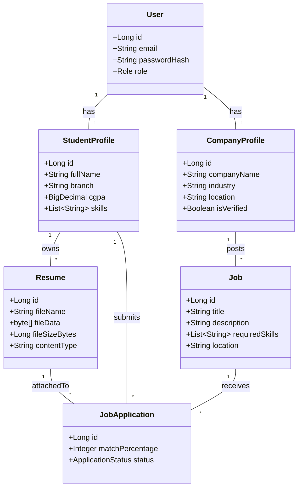
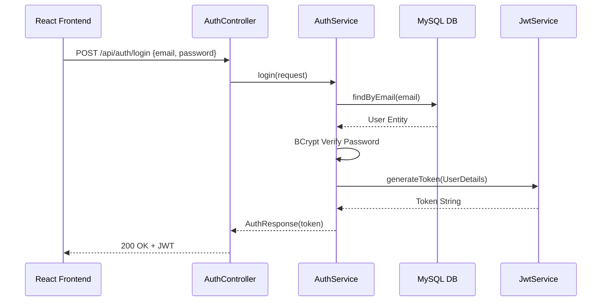
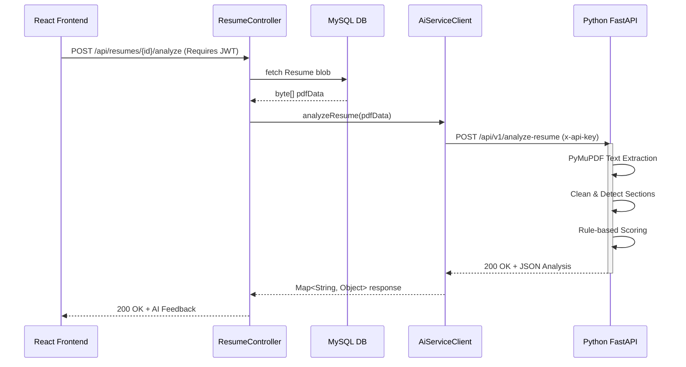
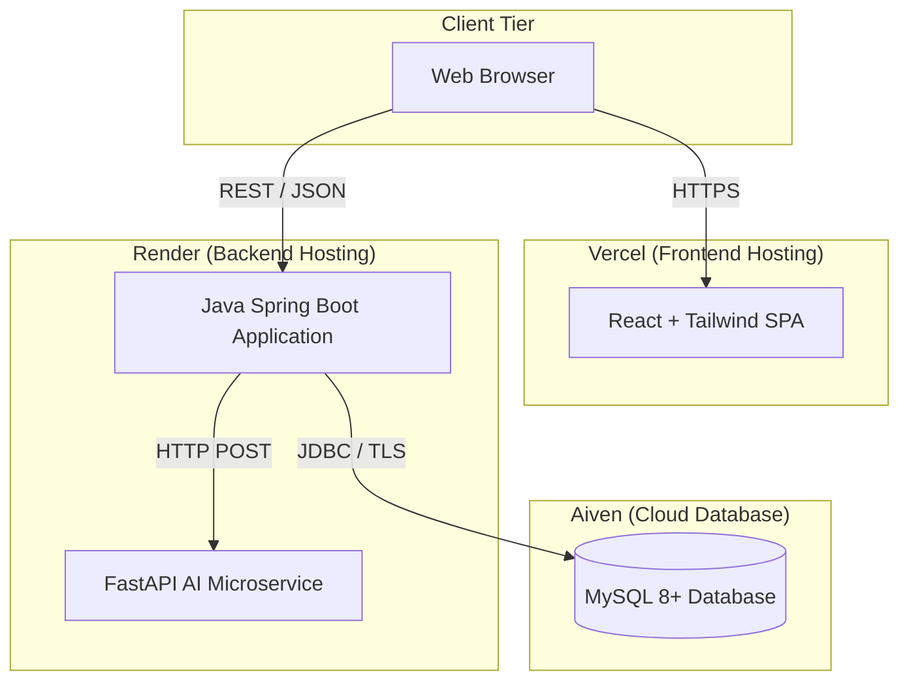

# UML Design
**Project Title**: CareerAI — AI-Based Placement & Resume Analyzer

## 1. Use-Case Diagram

```mermaid
usecaseDiagram
    actor Student
    actor Company
    actor Admin

    package "CareerAI System" {
        usecase "Register & Login" as UC1
        usecase "Upload Resume" as UC2
        usecase "Get AI Resume Analysis" as UC3
        usecase "Apply for Jobs" as UC4
        
        usecase "Post Job Openings" as UC5
        usecase "View Candidate Matches" as UC6
        usecase "Schedule Interviews" as UC7
        
        usecase "View System Metrics" as UC8
        usecase "Manage Users" as UC9
    }

    Student --> UC1
    Student --> UC2
    Student --> UC3
    Student --> UC4

    Company --> UC1
    Company --> UC5
    Company --> UC6
    Company --> UC7

    Admin --> UC1
    Admin --> UC8
    Admin --> UC9
```

## 2. Class Diagram (Core Entities)



## 3. Sequence Diagram: Authentication (JWT Flow)



## 4. Sequence Diagram: AI Resume Analysis



## 5. Deployment Diagram


