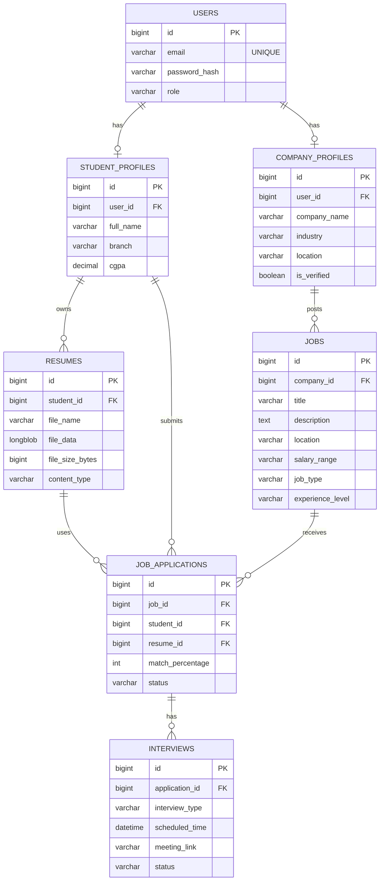

# Database Design
**Project Title**: CareerAI — AI-Based Placement & Resume Analyzer

## 1. Introduction
The database for CareerAI is implemented using **Aiven MySQL** (MySQL 8+). The database uses a highly normalized schema and is fully managed via Spring Data JPA (Hibernate) using `ddl-auto=update` for smooth schema evolution.

## 2. Entity-Relationship (ER) Diagram

## 3. Data Dictionary

### Table: `users`
Stores all authentication credentials and roles for the platform.
- **id** (BIGINT, Primary Key, Auto-increment)
- **email** (VARCHAR(255), Unique, Not Null)
- **password_hash** (VARCHAR(255), Not Null)
- **role** (ENUM: `ROLE_STUDENT`, `ROLE_COMPANY`, `ROLE_ADMIN`)

### Table: `student_profiles`
Stores extended information for student users.
- **id** (BIGINT, Primary Key)
- **user_id** (BIGINT, Foreign Key -> `users.id`)
- **full_name** (VARCHAR(255))
- **branch** (VARCHAR(100))
- **cgpa** (DECIMAL(4,2))
- *(Note: Skills are managed via a cross-reference table generated by JPA `@ElementCollection`)*

### Table: `company_profiles`
Stores extended information for company recruiters.
- **id** (BIGINT, Primary Key)
- **user_id** (BIGINT, Foreign Key -> `users.id`)
- **company_name** (VARCHAR(255))
- **industry** (VARCHAR(100))
- **location** (VARCHAR(255))
- **is_verified** (BOOLEAN)

### Table: `resumes`
Stores the actual PDF documents as BLOBs to ensure strict access control.
- **id** (BIGINT, Primary Key)
- **student_id** (BIGINT, Foreign Key -> `student_profiles.id`)
- **file_name** (VARCHAR(255))
- **file_data** (LONGBLOB) - Stores the binary PDF data.
- **file_size_bytes** (BIGINT)
- **content_type** (VARCHAR(100))

### Table: `jobs`
Stores job postings created by companies.
- **id** (BIGINT, Primary Key)
- **company_id** (BIGINT, Foreign Key -> `company_profiles.id`)
- **title** (VARCHAR(255))
- **description** (TEXT)
- **location** (VARCHAR(255))
- **salary_range** (VARCHAR(100))
- **job_type** (ENUM: `FULL_TIME`, `PART_TIME`, `INTERNSHIP`)

### Table: `job_applications`
Associates a student and their resume with a specific job posting.
- **id** (BIGINT, Primary Key)
- **job_id** (BIGINT, Foreign Key -> `jobs.id`)
- **student_id** (BIGINT, Foreign Key -> `student_profiles.id`)
- **resume_id** (BIGINT, Foreign Key -> `resumes.id`)
- **match_percentage** (INT) - Calculated by the Python AI service.
- **status** (ENUM: `APPLIED`, `SHORTLISTED`, `INTERVIEW`, `REJECTED`, `HIRED`)

## 4. Normalization and Data Integrity
- The database is normalized to the **Third Normal Form (3NF)**.
- **Referential Integrity**: Foreign keys enforce structural integrity (e.g., a `Resume` cannot exist without a `StudentProfile`).
- **Unique Constraints**: The `email` column in the `users` table is heavily indexed and unique to prevent duplicate registrations.
- **BLOB Storage**: Resumes are stored as `LONGBLOB` internally to prevent unauthorized direct URL access that typically occurs with cloud buckets, ensuring strict Role-Based Access Control (RBAC) via the Java backend.
